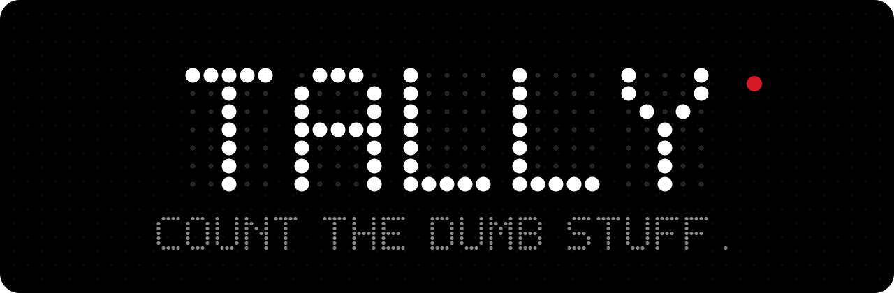
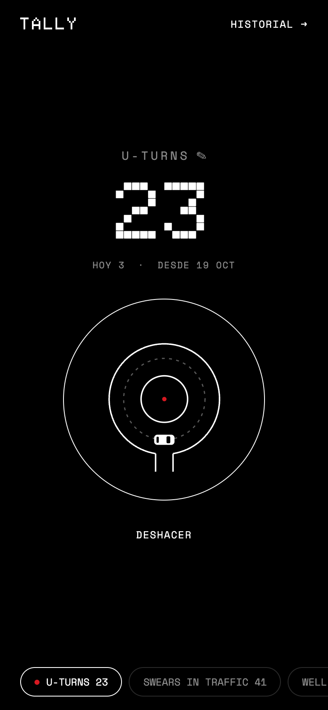
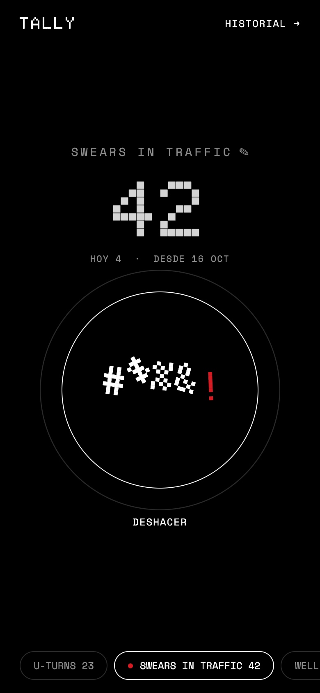
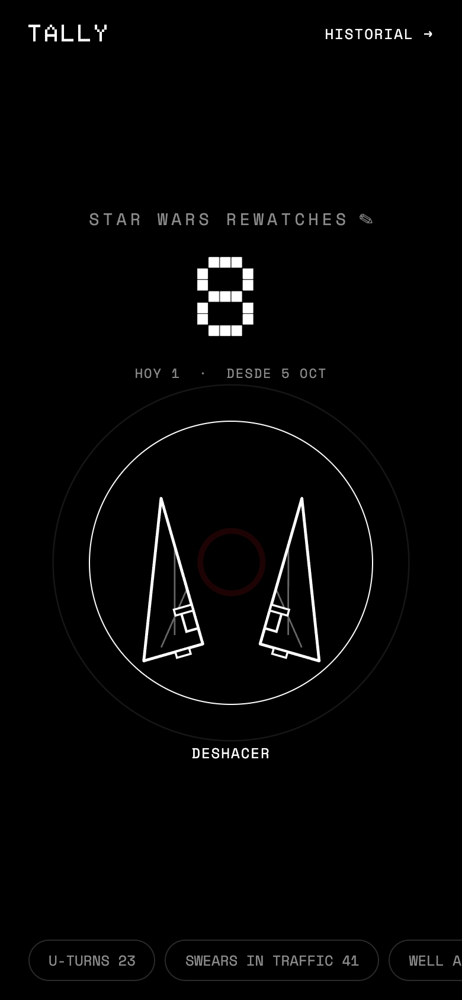
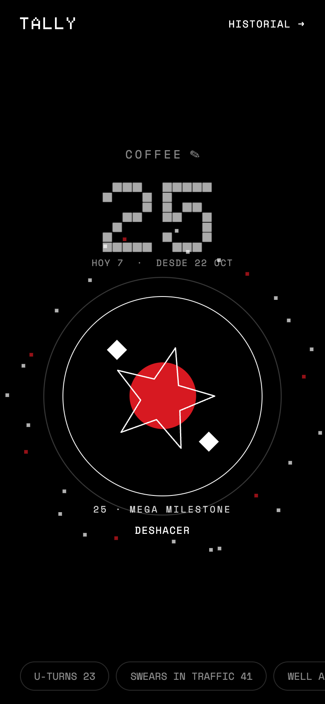
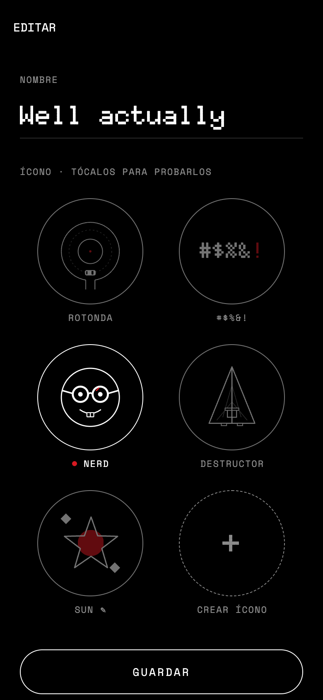
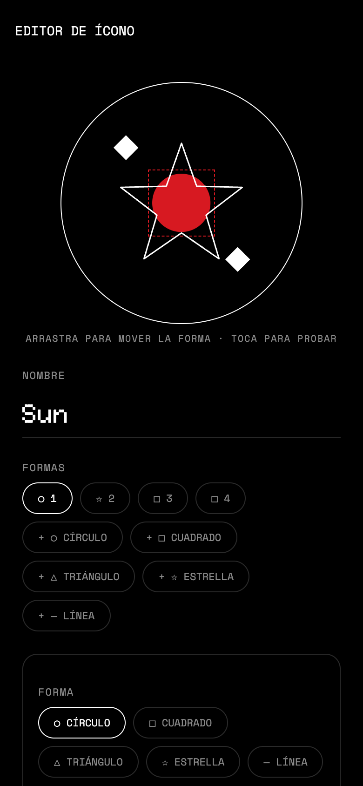
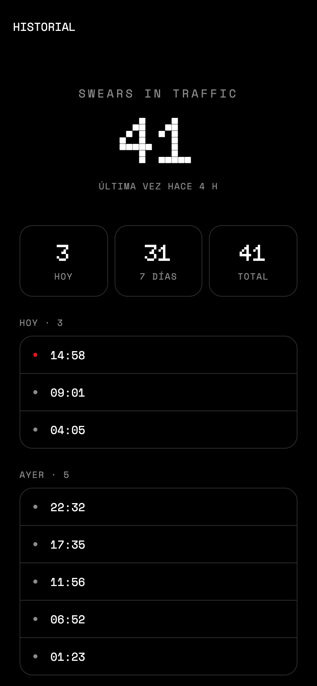

<p align="center">
  
</p>

<p align="center">
  <code>● ONE BUTTON</code>&nbsp;&nbsp;<code>○ ZERO EXCUSES</code>&nbsp;&nbsp;<code>◌ PURE BLACK</code>
</p>

<p align="center">
  
  &nbsp;
  
  &nbsp;
  
</p>

---

### ● &nbsp;WHAT IS THIS

A counter. That's it. You pick a thing (U-turns, swears in traffic, coffees, the times someone says *"well, actually"*) and you smack the big circle every time it happens.

It remembers what you counted last and puts it front and center, so the whole flow is: open, tap, close. Pure black, thin white lines, dot-matrix numbers, one red dot. Nothing OS energy.

### ● &nbsp;EVERY TAP DOES SOMETHING

| | |
|:--|:--|
| **ROUNDABOUT** | A tiny car laps a top-down roundabout. Tap faster, it keeps going. |
| **#$%&!** | Comic-strip swear symbols jump in a wave, tilt, land and the whole thing shakes. |
| **NERD** | Pushes his glasses up, blinks, tilts his head. Insufferable. |
| **DESTRUCTOR** | Splits clean down the middle with a red flash, floats there, snaps back together. |

### ● &nbsp;MILESTONES



Every **5th** tap the button bursts dot-matrix pixels, the number jumps and a `MILESTONE` label flashes in.

Every **25th** is a **MEGA MILESTONE**: twice the pixels, twice the distance, zero chill.

You don't need this. You will want it anyway.

<br clear="right"/>

### ● &nbsp;MAKE YOUR OWN ICON

<p align="center">
  
  &nbsp;
  
  &nbsp;
  
</p>

Don't like the built-ins? Build one. Drop in circles, squares, triangles, stars and lines, drag them around the canvas, and give each one a move: **spin, pulse, float, blink, orbit, shake or bounce**. Set the speed, stagger them with a delay, and they all fire on every tap.

Also in the box: **history** (today / 7 days / total, every tap by day), **rename**, **undo**, and **long-press to drag** your counters into order.

### ● &nbsp;RUN IT

```bash
npm install
npx expo start
```

Press `w` for the browser, or scan the QR with [Expo Go](https://expo.dev/go) on your phone. Saves reload instantly.

### ● &nbsp;MESS WITH IT

Every animation knob (durations, springs, how far the pixels fly, how hard the swears jump) lives in **one file** with a comment on every value:

```
src/animations/config.ts
```

Change a number, save, watch it happen.

```
src/
├── app/          screens: home, history, counter editor, icon editor
├── icons/        built-in animated icons + the custom icon renderer
├── components/   the big button, the chips row, the milestone burst
├── animations/   config.ts: every knob
└── lib/          storage for counters and custom icons, date helpers
```

---

<p align="center">
  <sub>Built with <a href="https://expo.dev">Expo</a>, React Native and Reanimated.&nbsp;&nbsp;<code>●</code></sub>
</p>
